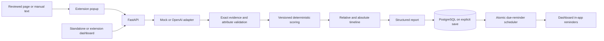

# Architecture and operating decisions

The repository is a modular FastAPI backend plus one React/TypeScript source
tree with separate extension and dashboard build outputs. The shared source
avoids duplicating report rendering and account clients. The extension build
contains the MV3 worker/content entries; the standalone dashboard build has
its own HTML and React entry and contains no extension manifest requirement.

Authentication uses short-lived HS256 access tokens tied to revocable database
refresh sessions. Refresh rotation is a conditional database update, with one
winner under concurrent use. A Web Lock serializes client requests, refresh,
profile editing, logout and account deletion. Every private query includes an
owner constraint. Cross-owner identifiers return the same 404 as absent IDs.

Saved reports are immutable server-generated JSON snapshots, accompanied by
relational findings and commitments. The schema has users, refresh_sessions,
analyses, findings, commitments and reminders. Foreign keys and ORM cascades
delete the owned graph. Migration 0002 adds reports; 0003 adds confirmed event
times, timezone, notes and unique per-user reminder request keys. The initial
migration remains the source of base-table definitions.

Reminder scheduling uses an atomic UPDATE from scheduled to due. It needs no
external delivery transaction because the durable due row is the in-app notice.
Polling and scheduler retries cannot create a second notice. A separate
acknowledgement records review; rescheduling clears that acknowledgement.
Creation retries reuse a per-user key and reject changed payloads. Relative
commitments do not become calendar dates until the user explicitly confirms
an event and chooses an earlier reminder time.

No model controls the final score. See `backend/app/risk/engine.py` for versioned
weights, severity values, duplicate handling and coverage gating. Absent
categories are unassessed; they are not zero risk. See `docs/ai-evaluation.md`
for measured synthetic results and their limitations.

The API caps request bodies at 1 MB before JSON parsing, bounds sections and
provider responses, and limits authentication and analysis attempts per client
address. These limiters are process-local; multi-worker deployment requires
shared limits at a trusted ingress. Never trust arbitrary forwarded addresses.
Hosted extraction has bounded retries/timeouts, a configured output-token limit
and conservative preflight cost estimates using operator-supplied token prices.
Account health endpoints and scheduler transition counts provide basic
operational signals. No raw page bodies are intentionally logged.
