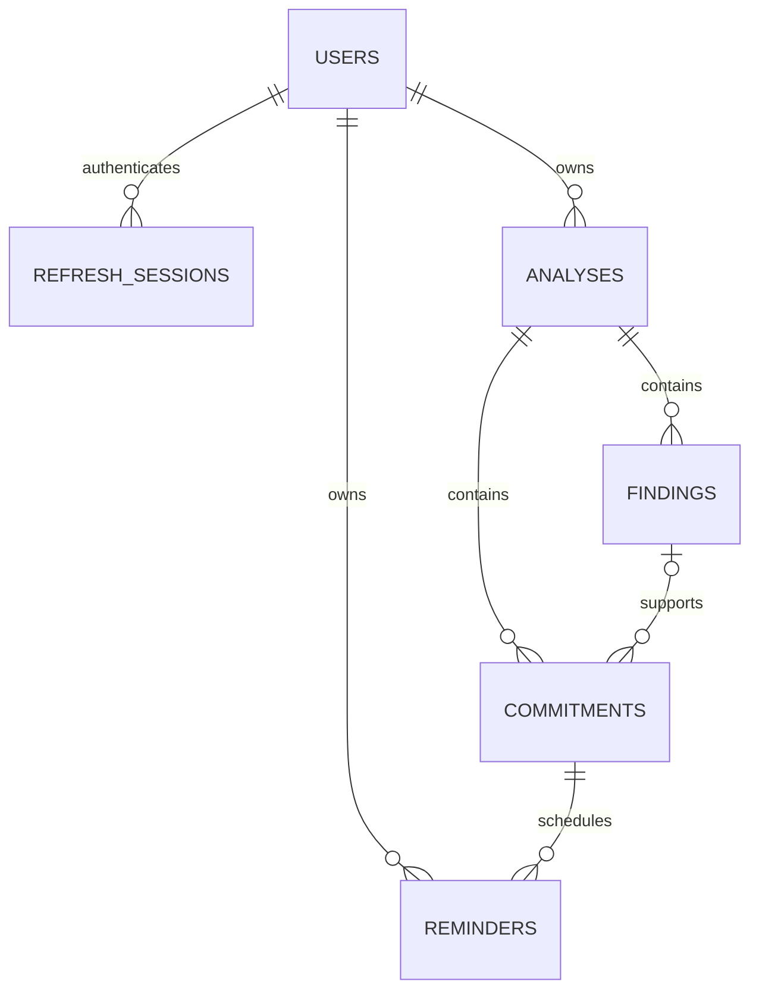

# Data model

Users contain a display name, normalized unique email and Argon2id password
hash. Refresh sessions contain only a token digest, expiry, revocation time and
owner. Access tokens carry a session ID; every authenticated request checks
that the owner and session still exist and are active.

Analyses contain source metadata, score/version, coverage status and the
server-generated JSON report snapshot. Findings retain evidence excerpts and
source locators. Commitments project timeline items; their relative_rule JSON
retains unresolved assumptions. Raw extracted section bodies have no database
column. The evidence excerpt and report can still contain sensitive text.

Reminders point to a commitment and user, contain a confirmed UTC event time,
an earlier UTC reminder time, IANA timezone and user note. The unique
(user_id, idempotency_key) constraint makes creates retry-safe. Existing rows
from before migration 0003 can have no event time/key; they remain listable.
Status transitions are scheduled → due → acknowledged, with cancellation
available independently. Editing an active reminder resets it to scheduled.

Ownership is enforced in API queries and foreign keys. Account deletion
cascades through the owned graph and sessions; analysis deletion cascades
through its findings, commitments and account reminders. Browser-local
reminders are outside this schema. Cancelled reminders remain until their
owning report/account is removed. PostgreSQL is the deployment engine; SQLite
metadata-created databases are used for fast isolated tests.
